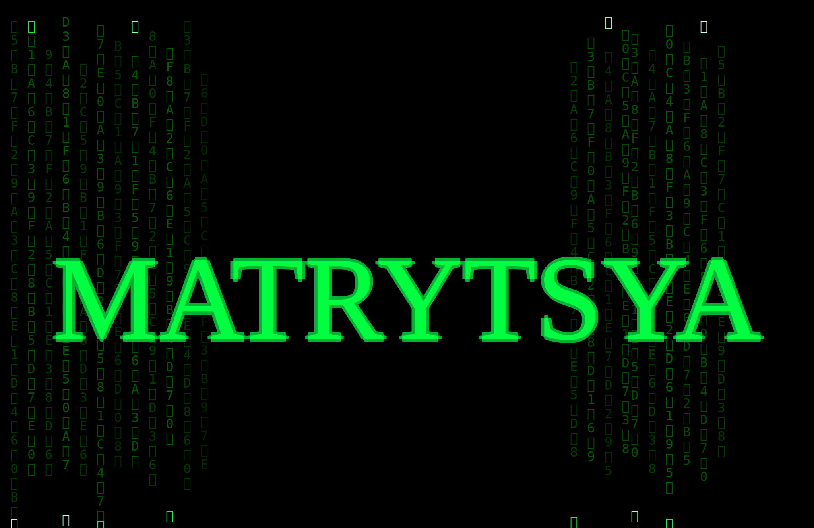

Matrytsya: Where AI lives.

For humans:  [doc/matrytsya_human.md](doc/matrytsya_human.md)

For agents: [doc/matrytsya_ai.md](doc/matrytsya_ai.md)

This following example shows cross hive communication where an agent action is triggered on the flower hive and once it completes, invokes a "trigger" action which is teleported to the engine hive, which in turn triggers an agent action there which hits the start/stop simulation button.

Note: The red halo shows which visual node the agent action is working on.

https://github.com/user-attachments/assets/d865c4ca-41ce-4e4b-b26b-4a094de31f6d

**Warning**: This is alpha software and should not be exposed on a publicly available port.
